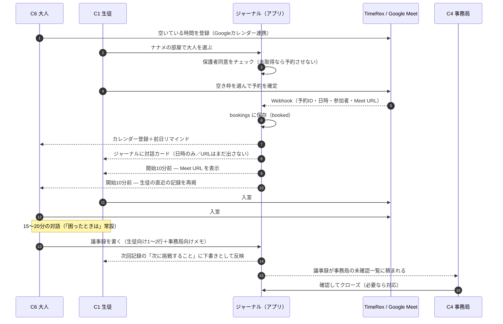
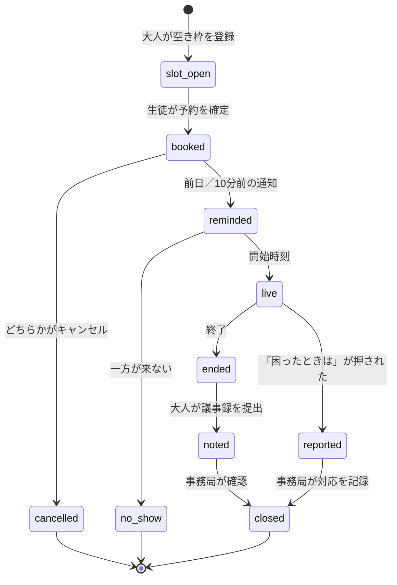

# シナリオ1 — 空き枠登録から議事録が事務局に返るまで

ナナメの部屋の**背骨になる一本**。登場するのは3人（[キャラ設定](nanameya.md)）。

- **C6 三浦いずみ**（加入済みのナナメの大人）… 自分の空いている時間を出す
- **C1 佐藤みなと**（生徒）… その時間を予約する
- **C4 事務局かなえ**… 終わった対話の議事録を受け取る

対話は **15〜20分**（実装計画では15〜30分だったが、ここで15〜20分に寄せる）。

---

## 1. 流れ

## 2. ステップ詳細

| # | 誰が | やること | システムがやること | 画面 |
|---|---|---|---|---|
| 1 | C6 大人 | 空いている時間を登録する | TimeRexにGoogleカレンダーを接続。空き枠だけが生徒に見える | ボランティア画面（枠登録） |
| 2 | C1 生徒 | 大人を選ぶ | **保護者同意を確認。未取得なら予約ボタンを出さない** | ナナメの部屋トップ ✅ |
| 3 | C1 生徒 | 空き枠を選んで確定 | TimeRexウィジェットで確定。二重予約はTimeRex側が防ぐ | 大人の詳細 → 予約 |
| 4 | — | — | Webhookを受信し `bookings` に保存。**予約IDでdedupe**（再送で二重登録しない） | （API） |
| 5 | — | — | 大人：カレンダー＋メール／生徒：**アプリ内**に対話カード | ジャーナル・ナナメの部屋 |
| 6 | — | — | **開始10分前になって初めて生徒にMeet URLを出す** | 対話カード |
| 7 | 両者 | 入室して15〜20分話す | 「困ったときは」を常設。押すと事務局へ即時通知 | 対話画面 |
| 8 | C6 大人 | 議事録を書く | 生徒向けパートだけが生徒に見える。事務局向けパートは生徒に見せない | 議事録入力 |
| 9 | — | — | 生徒の次回記録の「次に挑戦すること」に**下書き**として挿入（生徒は編集・破棄できる） | 記録入力 |
| 10 | C4 事務局 | 議事録を確認してクローズ | 未確認のまま溜まっているものが一覧で見える | 事務局 管理画面 |

## 3. 決めごと（この流れで確定させたい設計判断）

**A. Meet URL は開始10分前まで生徒に出さない。**
予約確定時にリンク自体は発行されるが、早く配ると時間外の接続やリンクの流出が起きる。
大人側はカレンダー経由で持っているので、実質「開始直前に二人が同じ部屋に入る」形になる。

**B. 生徒への通知はアプリ内を正とする。**
中学生にメール・LINEを前提にできないため、ジャーナルを開けば対話カードが出ている状態を正とする。
大人・保護者・事務局にはメール（＋P1でLINE）。

**C. 議事録は「大人が書く構造化メモ」であって、自動の全文書き起こしではない。**
実装計画のNon-Goalで通話の全文書き起こしを外しているため、ここでもそれに合わせる。
議事録は2つのパートに分ける:

| パート | 書く量 | 誰が読む | 使われ方 |
|---|---|---|---|
| **生徒向け**（次にやってみるといいこと） | 1〜2行 | 生徒・事務局 | 次回記録の「次に挑戦すること」の下書きになる |
| **事務局向け**（実施の可否・気になったこと） | 任意 | 事務局のみ | 安全確認・伴走の質のふりかえり |

> 自動文字起こし（Meetの録画・字幕をAI要約）にする選択肢もあるが、Non-Goalの変更になるので今回は採らない。
> 変えるならこの章だけ差し替えれば、以降の画面はそのまま使える。

**D. 先生（C3）はこの流れに登場しない。**
実施の有無までは見えるが、議事録の中身は見せない（[キャラ設定 C3](nanameya.md)）。

## 4. 予約の状態

事務局の管理画面は、**`ended` のまま止まっているもの（議事録の未提出）と `noted` のまま止まっているもの（未確認）** が
一番上に来る作りにする。ここが詰まると安全確認が遅れるため。

## 5. データ（`bookings` の想定列）

| 列 | 内容 |
|---|---|
| `id` | アプリ側の予約ID |
| `timerex_id` | TimeRexの予約ID（**dedupeキー**。Webhook再送で二重登録しない） |
| `school_id` | 学校（マルチテナントのRow-level分離用） |
| `student_grade` / `student_cls` / `student_no` | 生徒（既存 `entries` と同じ主キー構成） |
| `volunteer_id` | 大人 |
| `starts_at` / `ends_at` | 日時 |
| `meet_url` | 通話リンク（生徒には開始10分前から出す） |
| `status` | 4章の状態 |
| `note_for_student` | 議事録・生徒向け（1〜2行） |
| `note_for_office` | 議事録・事務局向け |
| `noted_at` / `closed_at` | 提出・確認の時刻 |

## 6. この流れに必要な画面

| # | 画面 | ファイル | 誰の画面 | 状態 |
|---|---|---|---|---|
| 1 | 空き枠の登録 | `nanameya-volunteer.html` | C6 大人 | 未 |
| 2 | 大人一覧（同意ゲート） | `nanameya.html` | C1 生徒 | ✅ モック |
| 3 | 大人の詳細 → 予約 | `nanameya-book.html` | C1 生徒 | 未 |
| 4 | 対話カード（日時 → 10分前にURL） | `nanameya-session.html` | C1 生徒 | 未 |
| 5 | 対話直前の準備（生徒の記録） | `nanameya-volunteer.html` | C6 大人 | 未 |
| 6 | 議事録の入力 | `nanameya-note.html` | C6 大人 | 未 |
| 7 | 議事録の受信・確認 | `nanameya-admin.html` | C4 事務局 | 未 |

## 7. この流れの未決事項

- **TimeRexのWebhookに何が入るか**（参加者情報とMeet URLがどこまで含まれるか）。登録して実物で確認する。
- **ボランティア3〜5名の枠を一元管理できるか**（TimeRexの「チーム」機能か、個別アカウント運用か）。
- **開始10分前の判定をどこでやるか**（画面を開いた時のクライアント判定で足りるか、Queues＋通知が要るか）。
- **no_show の扱い**（何分で無断キャンセル扱いにするか、生徒側の再予約をどうするか）。
- **議事録の提出期限**（当日中か、翌日までか。未提出のリマインドを出すか）。
